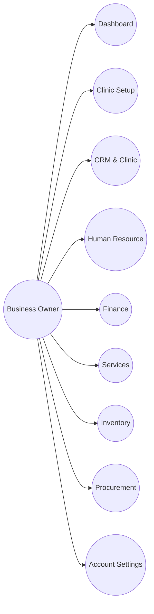

# Business Owner Clinic Management Use Case

## Identification Summary

**Title:** Business Owner Clinic Management  
**Summary:** This use case describes how a clinic owner manages clinic setup, customer and appointment operations, workforce, services, supplies, finances, and account settings in AesthetiCare. The diagram groups these activities under the nine owner navigation modules. Access to individual actions depends on the clinic subscription features and the signed-in account's permissions.  
**Primary Actor:** Business Owner (clinic owner account)  
**Supporting Actors:** Clinic employees, customers, practitioners, suppliers, payment providers  
**Version:** v1.0  
**Date of Update:** November 17, 2026

## Use Case Diagram

The Business Owner connects to the same nine modules shown in the supplied diagram. The detailed scenario below follows that module order; the bullets under each module are its project-specific subflows.

## Preconditions

1. The Business Owner has an active, authenticated clinic account.
2. The clinic and its data services are available.
3. The requested action is permitted for the account and, where applicable, enabled by the clinic's subscription and branch scope.

## Main Success Scenario

These are separate clinic-management tasks. The owner may perform any authorized task without completing the other modules in sequence.

1. **Dashboard — review the clinic overview.** Open **Dashboard** from the owner sidebar.
   - Review the clinic's branch overview, active staff, today's appointments, unread messages, revenue summaries, upcoming appointments, and other available operational indicators.
   - Dashboard results reflect the clinic records and branch data the owner is authorized to access.

2. **Clinic Setup — maintain clinic information and branches.** Open **Clinic Setup**.
   - In **Clinic Profile**, review and save permitted customer-facing clinic information, such as contact details, description, logo, and banner.
   - In **Branch Management**, view and edit permitted branch information, including the branch name, location, and assigned branch manager; manage clinic policies linked to a branch.
   - When the multi-branch feature is enabled, add branches and deactivate or reactivate them. Inactive branches appear in the **Archived Branches** list.
   - The first registered clinic location is designated the **Main branch**. Customer discovery uses that record as the clinic's primary location, but the current interface does not provide an action to assign the designation to another branch.
   - The Clinic Profile page saves profile edits; it does not have a separate publish action. The location map on that page is read-only, while branch location is managed in Branch Management.

3. **CRM & Clinic — manage customer and care operations.** Open **CRM & Clinic**.
   - Review client records and use the Walk-In Desk to create permitted walk-in visits.
   - Review booking requests and appointments, manage the service queue, and access related prescriptions, consultation, and treatment-session workflows when available to the account.
   - Review clinic transactions and respond to customer conversations in Inbox.
   - Manage booking availability when the subscription feature and permissions allow it.

4. **Human Resource — manage roles and employees.** Open **Human Resource**.
   - Create or update clinic roles with a name, description, and permissions. A role with no permissions is not available for staff assignment; at least one permission must be enabled first.
   - Assign employees one or more clinic roles and one or more authorized branches. Branch membership is assigned to the employee; the current role record does not have a separate branch-scope field.
   - Create employee accounts with required employee information, role, and branch assignments. New accounts begin in **Pending Activation** and require a password change at first sign-in. The system attempts to send the employee's welcome email.
   - Manage employee profiles, shifts, attendance, leave, and overtime according to the account's permissions and enabled features.

5. **Finance — review and process clinic financial work.** Open **Finance**.
   - Review authorized sales and income, expenses, budgets, payables, invoices, payment records, and finance reports.
   - Review and approve purchase-order or other finance requests when authorized and when the required budget or approval conditions are met.
   - Manage employee compensation, payroll, and payroll approvals when the payroll feature is enabled and the required permissions are assigned.
   - Financial records and actions remain limited by the owner's permissions and clinic/branch access.

6. **Services — maintain customer-facing listings.** Open **Services** and select **Service Listings**.
   - Create and edit service, consultation, and service-package listings; save drafts and archive listings when needed.
   - Submit financial terms for Finance review when required. Publish a listing after its required review is approved.
   - A **Service** represents a single visit. A multi-visit treatment course is represented by a **Service Package**, whose visits are scheduled separately.

7. **Inventory — monitor and receive supplies.** Open **Inventory**.
   - Review inventory records and stock levels, register items, and submit supply requests to Procurement.
   - Record received supplies so the accepted quantities can be added to inventory.
   - Use Pharmacy functions when enabled and authorized.

8. **Procurement — process supply requests and supplier records.** Open **Procurement**.
   - Review supply requests from Inventory, record supplier quotes, and prepare or manage purchase orders.
   - Route purchase orders for the required Finance approval. After delivery, Inventory records the received stock; Finance records the supplier invoice and payment.
   - Maintain the clinic's Supplier Directory. Suppliers are business contacts in AesthetiCare and do not sign in or receive orders through a supplier account.
   - The request, quote, purchase order, receipt, invoice, and payment record remain linked as one supply trail. Supplier purchasing and final payment are handled externally and recorded in the system.

9. **Account Settings — manage the owner account and clinic data tools.** Open **Account Settings**.
   - Update the owner profile and password, review notifications, submit a support report, and review activity records when authorized.
   - Review the subscription plan and select or renew an eligible plan through the available payment flow.
   - Review **Account Access** for the clinic-account closure option.
   - Generate and download clinic data exports from **Backup Database** when permitted. These exports contain selected clinic records; this screen does not create a complete Firebase backup and cannot restore deleted or changed records.

## Alternate and Error Flows

**A1. Subscription feature is unavailable**

1. The owner opens a feature that is not enabled for the clinic's current plan.
2. The system hides or denies access to the feature and identifies the subscription limitation where supported.
3. The owner may review eligible plans in Account Settings.

**A2. Permission or branch scope is insufficient**

1. The owner or an employee attempts to open a page or perform an action outside the assigned permissions or branch scope.
2. The system denies the operation. The action is not treated as saved or approved.
3. An authorized owner may update the role or employee branch assignments when permitted.

**A3. A required review or workflow step is pending**

1. The owner submits a listing or purchase order that requires review.
2. The system records it in the relevant pending state.
3. The listing is published or the order proceeds only after the required Finance or approval action succeeds.

**E1. A save, request, or service operation fails**

1. The system displays an error or failure state.
2. The requested change is not reported as successful unless the system confirms it.
3. The user may retry or ask an appropriately authorized owner or employee for help.

## Postconditions

1. Authorized clinic, branch, customer, workforce, service, supply, and financial information is available to the owner for the selected module.
2. Successful edits and approvals are persisted and reflected in the relevant module.
3. Employee roles, permissions, and branch assignments reflect saved changes.
4. Service listings, supply requests, purchase orders, receipts, invoices, and payment records retain their applicable workflow state and links.
5. Data exports are available for download when generation succeeds; they are not represented as restorable full-database backups.

## Project Alignment Notes

- The supplied diagram is a top-level module map. It intentionally does not show every child page or workflow step.
- Payroll is surfaced under **Finance** in the current owner navigation, although related workforce tasks are under **Human Resource**.
- The current interface does not expose a **Set Main Branch** action or a separate **Publish Clinic Page** action. A multi-branch owner can deactivate branches, so the UI does not guarantee that the main branch remains active.
- Role permissions are configured on clinic roles; employees receive branch assignments separately. Multi-branch access should therefore be described through employee branch membership, not role-level branch scope.
- The **Backup Database** page is a clinic-record export tool, not a full database restoration workflow.
