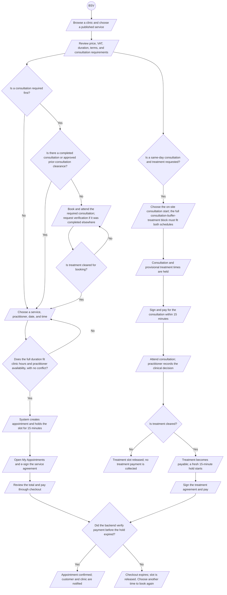

# Customer Service Booking Flow

This flow follows the customer-facing service booking process in AesthetiCare, from the **BSV** connector through verified payment. BSV is shown as the connector label requested; it is not expanded into an acronym here.

## Notes

- The customer must be signed in to submit an online booking.
- Availability is the intersection of the clinic's opening hours and the practitioner's published schedule. The complete appointment duration must fit inside both, and the backend repeats the check when the booking is created.
- The system creates a 15-minute payment hold after validating the selected time. The customer signs and pays in **My Appointments**. Verified payment confirms the appointment and notifies the clinic; a checkout that expires before payment releases the slot.
- A service with a consultation prerequisite cannot be booked for treatment until the linked consultation is complete or the clinic approves verification of an earlier consultation.
- For same-day on-site consultation and treatment, only the consultation is initially payable. Treatment remains provisional until the practitioner clears it, then gets a fresh 15-minute signature-and-payment hold.
- Eligible group bookings use the same 15-minute rule. The organizer signs and pays once; each attendee completes their own treatment consent before check-in.
- Payment is not confirmation until the backend verifies the provider's payment record.
