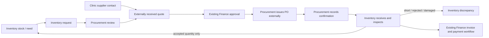

# Inventory and Procurement Scope Design

**Status:** Approved for implementation  
**Date:** 2026-11-11

## Intent

Keep the clinic supply workflow focused on two internal departments: Inventory and Procurement. Retire supplier login/portal workflows and the standalone supply Logistics workspace. Move delivery receiving, inspection, and accepted-stock onboarding under Inventory.

This matches the current clinic-only supplier direction already described by the Supplier Directory and supply architecture. Some older backend branches and validation documents still describe supplier accounts and a Logistics department; this change brings those surfaces into line.

## Goals

- Keep an end-to-end, auditable path from stock need to purchase receipt.
- Keep supplier business contacts and clinic-maintained supplier/product details.
- Let Procurement record supplier quotations, confirmations, and supporting documents received outside the platform.
- Let Inventory receive and inspect full or partial deliveries, record discrepancies, and add only accepted quantities to stock.
- Remove external supplier account access and the separate Logistics department from the supply workflow.
- Preserve existing supply records and linked inventory movements.

## Non-goals

- Remove Finance's existing budget approval, invoice review, or payment-recording workflow.
- Remove the clinic supplier directory, supplier catalog data, or local regulatory-check fields such as FDA LTO status.
- Delete historical supplier user records, Firebase Auth accounts, or historical Online-mode transactions.
- Remove customer-order fulfillment or the general `orders:view` / `orders:update` capabilities if other parts of the app use them.
- Change clinic subscriptions, unrelated supplier-linked services, bookings, or pharmacy/POS behavior.
- Initiate real supplier payments or external supplier messaging from the platform.

## Selected approach

### Clinic-only supplier records; Inventory owns receipt

The platform keeps supplier contacts as clinic-managed records. Supplier accounts do not sign in, access supply records, submit quotations, confirm purchase orders, upload supplier-side invoices, or use supplier chat. Clinic Procurement staff capture supplier-provided terms and responses from external documents or conversations and attach internal evidence to the purchase record.

The workflow becomes:

Procurement continues to own sourcing, quote comparison, funding request preparation, PO approval handoff, and external PO issue. Procurement records supplier confirmation and expected delivery. Inventory owns the receiving record, inspection results, lot/expiry/equipment data, discrepancy resolution, and stock onboarding. Finance remains a separate department in the broader application and retains the existing approval and payment workflow.

Receiving keeps the current data invariants: accepted plus rejected equals delivered; accepted quantities cannot exceed the outstanding PO quantity; rejected or damaged quantities never enter usable stock; partial deliveries leave outstanding PO quantities open; retrying stock onboarding does not double-post; each accepted receipt creates a linked lot and inventory movement.

Use the existing Inventory create permission for receiving/inspection/onboarding. Procurement can view the linked receipt status and history. Do not add a new Logistics role or require `orders:update` for supply receipts. Preserve `orders:update` wherever customer-order workflows still use it.

## Supplier account boundary

- Preserve clinic-associated supplier records, contacts, supplier catalog/product information, relationship status, and local regulatory-check metadata.
- Keep quotes, supplier confirmations, invoices, and payment evidence as clinic-authored records and uploads.
- Remove supplier-facing app routes and supplier-only supply API behavior. Existing supplier-role logins remain historical data and must not gain application access; do not bulk-delete accounts or supplier records.
- New procurement is clinic-entered/manual. Historical Online-mode supply records remain viewable for audit but are not migrated, rewritten, or used to permit new supplier-account activity.
- Keep internal document visibility. Do not expose a supplier-facing document projection or supplier notifications.

## Inventory and Logistics boundary

- Add an Inventory receiving/inspection view, preferably at `/inventory/receiving`, using the existing receiving and inspection records and backend transaction model.
- Move the current delivery onboarding action into this Inventory flow. Inventory should be able to record the receipt and onboard accepted stock from the same Inventory module; audit records must retain who performed each action.
- Remove the supply Logistics navigation entry, active route, dashboard metrics, filters, report mode, department ownership labels, and Logistics-only supply notifications.
- Redirect existing supply Logistics bookmarks to the equivalent Inventory receiving page. Keep unrelated customer-order screens and order permissions working.

## Compatibility and data handling

- Do not delete or bulk-convert `suppliers`, `clinicSuppliers`, `supplyRecords`, historical user accounts, or past Online-mode records.
- Preserve existing supplier references on inventory items and purchase records so reports, POS, booking, and historical traceability continue to resolve.
- Keep historical Logistics and supplier-account URLs as redirects or clear unsupported-account responses; do not leave dead links or silent navigation loops.
- Update the supply process guide, architecture, validation notes, and production checklist so they describe only Inventory, Procurement, and the existing Finance handoff.

## Alternatives considered

1. **Clinic-only supplier directory and two supply departments (selected).** Removes external account and role complexity while keeping supplier traceability and the real receiving control inside Inventory. Fits the stated capstone scope.
2. **Remove supplier data entirely.** Rejected because purchase orders, supplier prices, receipts, invoices, regulatory notes, and inventory traceability need a supplier reference even when the supplier has no login.
3. **Keep supplier portal and separate Logistics department.** Rejected because it adds external onboarding, permissions, communications, and a third operating department beyond the desired core clinic process.

## Acceptance criteria

- Clinic supplier contacts remain manageable from Procurement; no supplier account is needed to create a supplier or complete a purchase.
- New procurement requests follow the clinic-entered/manual path and do not require an activated supplier login.
- Supplier-role users cannot access supply records, supplier-only endpoints, or supplier-facing pages.
- Inventory staff can record receiving/inspection and onboard accepted quantities; Procurement staff without Inventory permission cannot post stock.
- Receipt records preserve partial/rejected quantities, discrepancy resolution, audit history, lot data, and linked movements.
- The supply navigation exposes Inventory and Procurement, not a Logistics department. Legacy supply Logistics links lead to Inventory receiving.
- Existing Finance approval and payment records, old supplier associations, and historical Online records remain readable and traceable.
- User-facing process documentation and marketing copy no longer present supplier accounts or a standalone supply Logistics module as part of this workflow.

## Implementation calls

- Finance remains in scope as an existing app workflow because the request targets supplier accounts and the Logistics department, not Finance.
- The existing supplier directory's local regulatory-check fields remain, distinct from account verification or portal onboarding.
- `orders:update` remains available to unrelated customer-order workflows; supply receiving moves to Inventory permission checks.
- No production data migration or deletion is included.
