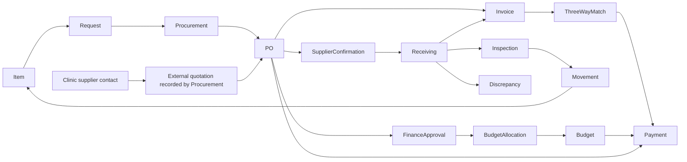
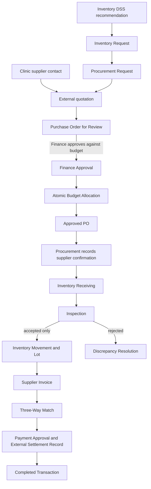
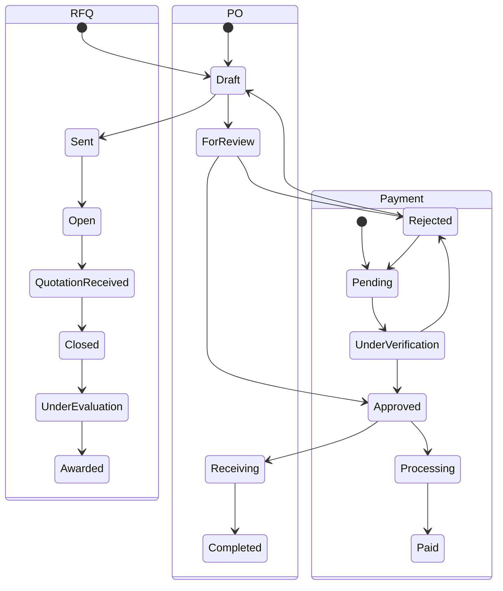
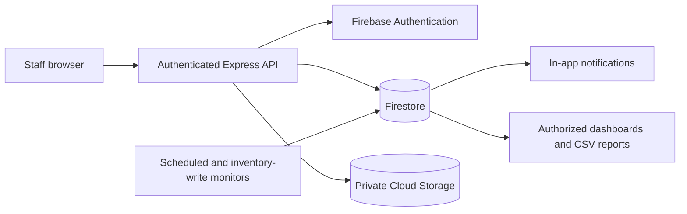

# Integrated supply management implementation

## Architecture and compatibility

Vue department workspaces use authenticated Express `/supply` APIs. Firebase Admin performs all workflow writes in transactions. Existing `inventoryItems`, `inventoryMovements`, `suppliers`, and supplier catalog records remain the shared sources of truth used by bookings and POS. Existing legacy purchase records stay accessible under explicitly labelled legacy screens; they are not silently converted or received again.

New workflow entities live in `supplyRecords` with a required `kind` discriminator. Their IDs are foreign keys within that collection. This keeps branch, visibility, audit, and linking rules consistent without duplicating inventory. All direct client access to new workflow collections is denied by the existing default Firestore rule. The server returns only authorized projections.

## Data schema / entity definitions

Every workflow record has `id`, `kind`, `number`, `branchId`, `status`, `createdBy`, `createdAt`, `updatedAt`, and `links` (IDs of preceding records). Amounts use integer centavos internally. Line items use inventory item IDs; quantities are positive whole units. No floating-point money arithmetic is used for funding or payment.

| Kind | Fields and relationships |
|---|---|
| request | itemId, item snapshot, department, quantity, unit, currentStock, minStock, reason, priority, requiredDate, estimatedCost; becomes linked procurement |
| procurement | requestId, inherited clinic need lines/department/reason/date, officer, selected supplier, external quotation reference/date, supporting documents |
| rfq / quotation / evaluation | Legacy records retained for historical review; new supplier quotes are recorded by clinic Procurement and do not use supplier accounts |
| budgetRequest | Legacy funding request records; new purchase orders go directly to Finance for approval against an allocated budget |
| budget | department, category, total, committed, spent; available = total - committed - spent |
| financeApproval | budgetRequestId, budgetId, approvedAmount, decision, remarks, financeOfficerId, decidedAt |
| budgetAllocation | budgetRequestId, financeApprovalId, budgetId, amount, spentAmount, releasedAmount, status |
| po | procurementId, budgetId, supplierId, quoted lines and totals, taxTreatment, itemized tax/fee/discount adjustments, supplier-stated total, quote reference/date, deliveryDate/location, terms, confirmation, accepted quantities, invoiced quantities, paid amount |
| supplierConfirmation | Clinic-entered record of an external supplier response: poId, supplierId, response, reason, confirmedDeliveryDate, recordedBy/recordedAt |
| receiving | poId, supplierId, reference, date, lines(ordered/delivered/accepted/rejected, condition, lot, expiry, serial/model/warranty), inspection, notes, onboarded |
| inspection | receivingId, poId, quantityResult, qualityResult, inspected lines, inspector and timestamp |
| discrepancy | receivingId, poId, supplierId, lines, reason, resolution, responsible user |
| invoice | poId, supplierId, receivingIds, invoiceNumber, invoiceDate/dueDate, lines, tax treatment, itemized tax/fee/discount adjustments, supplier-stated total, total, match result, approvedBy |
| threeWayMatch | invoiceId, poId, receivingIds, status, discrepancy issues, checker and timestamp |
| payment | invoiceId, poId, budgetId, supplierId, amount, method(Manual/External or Electronic), reference, paymentDate, proof document; recorded payment, not money transfer |

`supplyAudit`: recordId, branchId, actor UID/name/role, action, previous/new status, input snapshot, timestamp. Immutable server-written history.

`supplyDocuments`: recordId, branchId, uploader UID, filename, contentType, size, private Storage path, internal visibility, createdAt. Downloads require clinic staff record access. Historical supplier-owned assets remain readable to signed-in users, but new supplier uploads are disabled.

Inventory fields: existing `name`, `brand`, `description`, `imageUrl`, `category`, `itemType` (Material/Equipment), `consumability`, `unit`, `currentStock`, `reservedStock`, `minStock`, `targetStock`, `maxStock`, `location`, `supplierId`, `createdAt`, `receivedAt`, `expiryDate`, `condition`, `serialNumber`, `modelNumber`, `warranty`, `costPrice`. Receiving updates quantities through linked movement records only. Adjustments have reasons and audit records. Expiration and condition stay available per receipt/lot, not just the current item summary.

## ER diagram

## State machines and approval workflow

- Request: Draft -> Sent to Procurement -> Returned / Completed. Inventory records the need without choosing a supplier or price. Returned requests can be revised by their original requester.
- Procurement: Received -> For Review -> Ordered -> Completed, or Returned to Inventory / Rejected. Procurement selects an active clinic supplier, attaches the externally received quotation, and enters the quoted totals and terms.
- Finance approval: Finance approves the prepared PO against an allocated budget. Approval, Finance Approval, and Budget Allocation writes are transactional; a retry cannot reserve twice.
- PO: For Review -> Approved -> Receiving -> Completed, with For Review -> Rejected -> Draft for revisions. Procurement uploads the approved PO, issues it externally, then records the supplier response and expected date. Only confirmed POs are available to Inventory for receiving.
- Receiving: Inspected -> Onboarded. Inventory records delivered, accepted, and rejected quantities. Accepted + rejected equals delivered; cumulative accepted cannot exceed ordered. Onboarding is idempotent and rejected stock never enters inventory.
- Invoice: Submitted -> Under Verification -> Matched/Disputed -> Approved for Payment -> Paid. A separate Three-Way Match record compares PO, onboarded receiving, prior invoices, prices, and charges. Mismatches block payment.
- Payment: Pending -> Under Verification -> Approved/Rejected -> Processing -> Paid. Preparation, approval by another Finance user, processing, and settlement are separate actions. Settlement records a real external transaction; it never pretends to transfer money.

## Clinic-only supplier workflow

Suppliers are clinic-managed business contacts and do not log in. Procurement records supplier-provided quotations, taxes, delivery fees, discounts and other charges from external documents or communication, then generates the approved PO PDF for external delivery. Staff record supplier confirmation, receiving, invoices and payment references with supporting documents. Finance/Owner review is separate from Procurement preparation and sending. Historical Online-mode records remain readable and read-only; they do not enable new supplier access.

## Roles, scope, separation of duties

All staff requests resolve role/custom-role permissions and branch ownership through the existing user context. Suppliers are selected from clinic-associated business contacts; no supplier identity is accepted from a supplier login.

| Responsibility | Existing permissions |
|---|---|
| Inventory view/manage/request/receive | inventory:view, inventory:update, inventory:create |
| Inventory approval | inventory:review, different user from requester |
| Procurement read/source/evaluate/PO | procurement:view, procurement:create, procurement:review |
| Supplier directory | procurement:view, suppliers:create, suppliers:update |
| Procurement view/source/PO | procurement:view, procurement:create, procurement:review |
| Inventory receive/inspect/onboard/resolve | inventory:create |
| Finance view/budgets/verify | finance:payables:view, finance:payables:approve |
| Finance record settlement | finance:payables:settle |
| Branch administration | explicit permissions or administrator:full_access; duty separation still applies |

## API architecture

- `GET /supply/workspace?branchId=`: clinic staff accessible branches, role capabilities, entity records, item records, clinic supplier contacts/catalog; supplier roles are rejected.
- `POST /supply/items`: validated create/update and explicit opening quantity/adjustment with reason.
- `POST /supply/records`: type-specific clinic creation; Inventory requests are supplier-neutral, and new RFQ/quotation account flows are disabled.
- `POST /supply/records/:id/actions`: named state transitions, transactional invariants, audit and notifications.
- `GET /supply/records/:id/history`: authorized timeline and documents.
- `POST /supply/records/:id/documents`: private, internal-only document upload with metadata validation and bounded file sizes.
- `GET /supply/documents/:id`: authorized short-lived download.
- `POST /supply/reminders`: authorized, idempotent daily low-stock/deadline/delivery notifications; also invoked when the workspace is refreshed.

## Notification, audit, documents, and reporting architecture

Transitions create existing `notifications` records addressed to staff with the next department's permissions. Procurement handoffs go to Procurement or Finance; delivery receiving, inspection, and discrepancies go to Inventory. Alert IDs combine record/day/event to avoid repeated reminders. Browser workspaces refresh to update DSS and deadlines; reminders do not place orders. Unattended scheduled execution requires a deployment scheduler to invoke the same service.

Every mutation records an audit entry in the same database transaction. Document metadata is separate from Storage; failed metadata writes clean up the uploaded object. Allowed uploads: PDF, JPEG, PNG, up to 5 MB. No executable files or public buckets. Procurement documents are internal unless explicitly shared with the target supplier.

Inventory, Procurement, and Finance dashboards derive counters and chart series from the same authorized records. Reports provide search, type/status/department/supplier/category/date filters, sorting, pagination and CSV export. Detail views show related records, current owner, responsible department, next action, attachments and history. Finance displays total, committed, available and spent separately. Stock movement and receiving reports retain the IDs needed for backwards tracing.

## Validation plan

Static review checks clinic-only authorization, Inventory receiving permissions, accepted-quantity and idempotency invariants, historical Online-mode read-only handling, and legacy-route redirects. The frontend production build checks routes, templates, and imports. No live supplier communications, payments, database migration, or production deployment is part of the local implementation.

## Canonical workflow and compatibility routes

`SupplyWorkspace.vue` is the Inventory, Procurement, and procurement-Finance transaction interface. Inventory receiving and inspection are at `/inventory/receiving`. Older `/logistics/*`, `/manager/logistics`, and `/supply-management/logistics/*` URLs redirect to that page. Historical `purchaseRequests`, `supplierQuotes`, `purchaseOrders`, `manualPurchases`, and `purchasePayments` records remain readable for audit; historical Online-mode supply records are read-only and are not converted. New transactions use the clinic-entered manual path in `supplyRecords`.

Clinic users enter through module-owned namespaces: `/inventory`, `/procurement`, `/finance/procurement`, and `/management/supply`. Suppliers are represented as clinic-managed business contacts. Router guards, backend permissions, branch checks, and record access protect internal requests, budgets, approvals, quotations, and receiving.

## Deployment architecture

The API is the only workflow writer. Transactions enforce state preconditions, branch ownership, clinic supplier association, idempotency, budget availability, accepted quantities, invoice matching, and settlement. Supplier accounts receive no projection or supply notifications; documents remain internal clinic records.

## Completion design

Background monitoring runs in Firebase Functions: an inventory write trigger updates a daily item snapshot and in-app stock notifications; an hourly scheduled sweep covers expiration changes and RFQ/delivery/invoice deadlines even with no browser open. Notification IDs include recipient, record, event and day. `supplySnapshots/{branch-item-day}` stores branchId, itemId, date, currentStock, minStock, maxStock, flags and timestamp. Snapshot history powers low-stock trends without inventing historical values.

Named report definitions select authorized records and derive financial amounts from payment records, not quotations. Supplier performance compares confirmed delivery dates with actual receiving dates and reports accepted/rejected quantities. Management tracing follows the shared IDs. Report exports include their actual data fields, not a fixed abbreviated subset.

RFQ drafts can be edited before issue; cancellation requires a reason and allows re-sourcing when no funded order exists. Procurement can restart sourcing after an expired/rejected award, retaining old RFQs, quotations and decisions. Inventory draft edits and invoice revisions preserve before/after audit values. Review, approval and payment preparation are named actions, not unrestricted status edits. Read-only dashboards never write purchasing records.

Every staged workflow change receives an audit record (including generated child records and budget movements), and notifications follow each changed record to its responsible department. Private supplier communications have an explicit supplier recipient and cannot be shared with competitors. Document types distinguish invoices from payment evidence.
