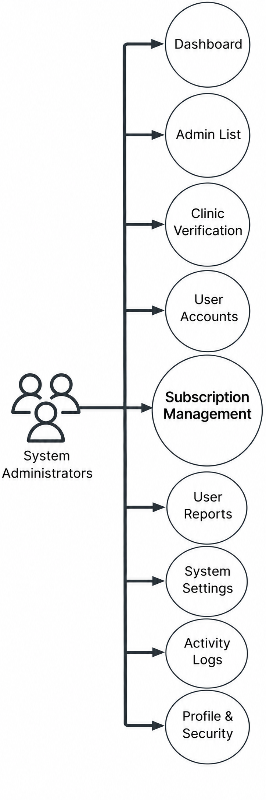

# System Administrator Management Use Case

## Identification Summary

**Title:** System Administrator / Platform Administrator Management  
**Summary:** This use case describes platform-level administration in AesthetiCare. Depending on assigned permissions, a System Administrator may view platform-wide dashboard metrics; create, edit, enable, or disable administrator accounts and assign role-based permissions; review clinic registration documents and approve, request resubmission, or reject applications; view user and clinic account records; configure the paid subscription plans and their feature access; review subscription payments and platform payment analytics; manage user-reported support tickets; publish maintenance notices, product updates, and announcements; review System Administrator activity logs; and manage their own profile and security settings. These are platform responsibilities. Clinic owners and authorized clinic staff manage clinic appointments, patient care, inventory, procurement, HR, and clinic finances. Clinic account closure is initiated by the clinic owner and does not require System Administrator approval.

**Primary Actor:** System Administrator (access is limited by assigned role and permissions)  
**Supporting Actors:** Clinic owner/applicant, platform user or customer  
**Creation Date:** July 22, 2026  
**Date of Update:** November 16, 2026  
**Version:** v1.2  
**Person in Charge:** ____________________

## Use Case Diagram

## Flow of Events

### Preconditions

1. The System Administrator has an active account and is authenticated.
2. The administrator has the specific permission required for the module or action. Full platform access is not required for every administrator.
3. The platform and its data services are available.

### Main Success Scenario

The steps below describe separate administration tasks. An administrator performs only the tasks allowed by their permissions; they do not have to complete every section in one session.

1. **View the platform dashboard.** Open **Dashboard** from the System Admin navigation.
   - Review platform-wide metrics, including clinic and user counts, active subscriptions, subscription and revenue summaries.
   - Refresh the dashboard when updated figures are needed.

2. **Manage administrator accounts.** Open **Accounts - Admin List**.
   - Search and review existing System Administrator accounts and their status, role, and permissions.
   - Create an administrator using their name and email, with an optional phone number. Assign a built-in administrator role or choose custom permissions.
   - The new administrator receives an email to set up their password.
   - Edit an administrator's role or permissions, or enable/disable their account. The current administrator cannot disable themselves or edit their own access from this screen.

3. **Review clinic registrations.** Open **Verification** and select a pending registration.
   - Review the applicant and clinic information and inspect the submitted documents.
   - Use OCR results as a review aid only; confirm information against the original document. For the BIR certificate, confirm the tax classification from the document or request clarification when it cannot be determined.
   - Approve a complete and valid registration, request document resubmission with a required explanation, or reject the registration with a required reason.
   - The system records the review outcome. For a rejection, the pending account is removed and the applicant is sent the recorded reason and a re-registration link when email delivery succeeds.
   - Review approved and rejected registration records and their recorded outcomes from the verification views.

4. **View platform user accounts.** Open **Accounts - User Accounts**.
   - Search and filter the active account list by account information, role, or user type.
   - Review basic account information and status. This page is for viewing platform account records; clinic-level customer records and patient care remain under the clinic's own workflows.

5. **Manage subscriptions.** Open the **Subscription Management** section.
   - Under **Setup Plans**, review the fixed Free Trial offering, which provides 14 days of Premium access, and configure the Basic and Premium paid-plan details available in the plan setup screen.
   - Under **Permissions**, configure which features are available to Basic and Premium. Free Trial inherits Premium access.
   - Under **Payment History**, search payments made by clinic owners for their subscriptions.
   - Under **Analytics**, review subscription revenue, successful payment counts, active subscriptions, and charts for a selected date range.
   - These payment screens provide platform subscription reporting. They are not the clinic's appointment payment, payroll, expense, or refund workflow.

6. **Handle user reports.** Open **User Reports** and select a report to review its details.
   - Update its status as work progresses: Open, Under Review, In Progress, Awaiting User Response, Resolved, Dismissed, or Escalated.
   - Provide a resolution or dismissal note when closing a report. The system records status history and the response associated with the update.

7. **Publish platform communications.** Open **System Settings**.
   - Publish a maintenance notice with its schedule and expected impact, a product update with its release date, or an announcement for everyone, clinic owners/administrators, or customers.
   - Review previously published posts in the post history.

8. **Review administrator activity.** Open **Activity Logs**.
   - Search or filter recorded System Administrator activity, inspect action details, and export the available log records.

9. **Manage the administrator's own account.** Open **Account Settings - Profile & Security** to update profile information and manage password/security settings.

### Alternative Sequences

**A1. Clinic documents need correction or clarification**

1. The administrator finds a missing, unclear, or inconsistent document or detail during review.
2. The administrator enters the required explanation and requests resubmission, or rejects the application with a reason.
3. If resubmission is requested, the applicant is notified and submits corrected documents for another review.

**A2. Clinic registration is rejected**

1. The administrator enters a rejection reason and confirms the rejection.
2. The system records the rejection, removes the pending account, and attempts to email the applicant the reason and re-registration link.
3. The applicant may start registration again with corrected information and documents.

**A3. Administrator has a limited role**

1. The administrator opens a module or attempts an action outside their assigned permissions.
2. The system denies access to that module or action. The administrator must ask an appropriately authorized administrator to perform it or update their role.

### Error Sequences

**E1. Login credentials are incorrect**

1. The system does not authenticate the administrator and displays an error.
2. The administrator may retry or use the password recovery flow.

**E2. A platform operation fails**

1. The system displays an error when it cannot load or save the requested information.
2. The administrator may retry the operation. The requested change is not treated as successful unless the system confirms it.

## Postconditions

1. Authorized platform metrics and account records are available for review.
2. Administrator accounts and their role-based permissions reflect saved changes.
3. Clinic registration decisions, required remarks, and resubmission/rejection outcomes are recorded.
4. Subscription plan details and feature access reflect saved configuration.
5. Subscription payment reports and analytics are available for the selected data and date range.
6. Support reports have an updated status, status history, and any required closure note.
7. Published maintenance notices, product updates, and announcements appear in the system's post history and are made available to their selected audience.
8. System Administrator actions are available in the activity log when recorded by the system.

## UI (User Interface) Requirements

1. Provide a platform dashboard with clearly labeled platform-wide counts and subscription/revenue summaries.
2. Provide searchable, filterable administrator and user account lists, with administrator role and permission management controls restricted to authorized users.
3. Provide a clinic registration review screen that displays the applicant and clinic details, submitted documents, OCR review clues, decision controls, and required remarks for resubmission or rejection.
4. Group plan setup, feature permissions, subscription payment history, and subscription analytics under one **Subscription Management** navigation section. Clearly distinguish the fixed Free Trial from the Basic and Premium paid plans.
5. Provide subscription payment history and date-filtered analytics without presenting them as clinic-level finance tools.
6. Provide a support report detail view with status history, user response, and required resolution/dismissal notes.
7. Provide a post composer that distinguishes maintenance notices, product updates, and announcements, including the fields appropriate to each type.
8. Provide administrator activity search, detail viewing, and export controls.
9. Clearly indicate access restrictions and operation failures, and provide retry or recovery guidance where available.

## Non-Functional Requirements

1. Only authenticated administrators may access platform administration; access to each module and action must follow the administrator's assigned permissions.
2. Clinic registration decisions and other privileged changes must be authorized and persisted before the interface reports success.
3. Submitted clinic documents and account information must be visible only to authorized users and handled as sensitive data.
4. Important administration actions should retain an actor, timestamp, action, and outcome in the activity history where supported.
5. Tables, forms, status indicators, and feedback messages must remain readable and usable across screen sizes and light/dark themes.
